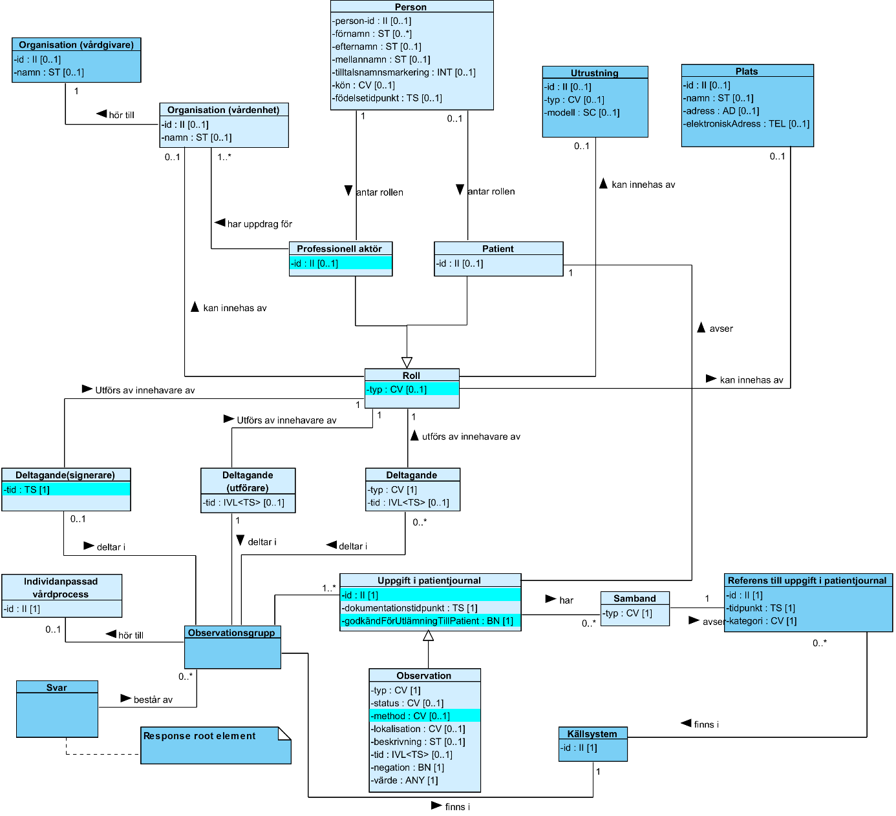

# 5 Tjänstedomänens meddelandemodeller - clinicalprocess: healthcond: basic v1.2.3

* [**Table of Contents**](toc.md)
* **5 Tjänstedomänens meddelandemodeller**

## 5 Tjänstedomänens meddelandemodeller

## Tjänstedomänens meddelandemodeller

Här beskrivs de meddelandemodeller som tjänstekontrakten bygger på. För varje meddelandemodell beskrivs hur mappning ser ut mot NI 2015:1 [R5] samt mot schema (XSD) för tjänstekontrakt.

### V-MIM – Observationer

 **Figur 5. Mörkblå klasser och cyanfärgade markeringar visar skillnader från NI release 2015:1. I vissa fall är det endast en avvikande kardinalitet.**

| | |
| :--- | :--- |
| ObservationGroup. sourceSystem | NI 2015.1Saknar motsvarighetI V-MIMKällsystem.id |
| Observation.id | Uppgift i patientjournal.id |
| Observation.type | Observation.typ |
| Observation.status | Observation.status |
| Observation.time | Observation.tid |
| Observation.method | NI 2015.1Saknar motsvarighetI V-MIMObservation.metod |
| Observation.value | Observation.värde |
| Observation.targetSite | Observation.lokalisation |
| Observation.valueNegation | Observation.negation |
| Observation.description | Observation.beskrivning |
| Observation.RegistrationTime | Uppgift i patientjournal.dokumentationstidpunkt |
| Observation.approvedForPatient | NI 2015.1Saknar motsvarighetI V-MIMUppgift i patientjournal.godkändFörUtlämnandeTillPatient |
| Location.id | NI 2015.1Saknar motsvarighetI V-MIMPlats.id |
| Location.name | NI 2015.1Saknar motsvarighetI V-MIMPlats.namn |
| Location.address | NI 2015.1Saknar motsvarighetI V-MIMPlats.adress |
| Location.electronicAddress | NI 2015.1Saknar motsvarighetI V-MIMPlats.elektroniskAdress |
| Patient.id | Person.person-id/Patient.id |
| Patient.name | Person.förnamnPerson.efternamnPerson.mellannamnPerson.tilltalsnamnsmarkering |
| Patient.dateOfBirth | Person.födelsetidpunkt |
| Patient.gender | Person.kön |
| LegalAuthenticator.id | NI 2015:1Saknar motsvarighetI V-MIMDeltagande(signerare)->Professionell aktör.id |
| LegalAuthenticator.time | NI 2015.1Saknar motsvarighetI V-MIMDeltagande(signerare).tid |
| LegalAuthenticator.name | NI 2015.1Saknar motsvarighetI V-MIMDeltagande(signerare)->Professionell aktör->Person.förnamn + Person.efternamn |
| SourceSystem.id | NI 2015.1Saknar motsvarighetI V-MIMKällsystem.id |
| Relation.code | Samband.typ |
| ReferredInformation.id | NI 2015:1Uppgift i patientjournal.idI V-MIMReferens till Uppgift i patientjournal.id |
| ReferredInformation.time | NI 2015:1Saknar motsvarighetI V-MIMReferens till Uppgift i patientjournal.tidpunkt |
| ReferredInformation.type | NI 2015:1Saknar motsvarighetI V-MIMSaknar motsvarighet |
| InformationOwner.id | NI 2015:1Saknar motsvarighetI V-MIMKällsystem.id |
| PerformerRole.id | NI 2015:1Saknar motsvarighetI V-MIMDeltagande->Roll->Professionell aktör.id eller patient.id/person.person-id |
| PerformerRole.code | NI 2015:1Saknar motsvarighetI V-MIMDeltagande->Roll.typ |
| Person.id | Person.person-id |
| Person.name | Person.förnamnPerson.mellannamnPerson.efternamnPerson.tilltalsnamnsmarkering |
| CareUnit.id | NI 2015:1Organisation.idI V-MIMOrganisation(vårdenhet).id |
| CareUnit.name | NI 2015:1Organisation.namnV-MIMOrganisation(vårdenhet).namn |
| CareGiver.id | NI 2015:1Organisation. idV-MIMOrganisation(vårdgivare).id |
| CareGiver.name | NI 2015:1Organisation.namnV-MIMOrganisation(vårdgivare).namn |
| AdditionalParticipant.id | NI 2015.1Saknar motsvarighetV-MIMProfessionell aktör.id (om sådan deltagare) |
| AdditionalParticipant.type | Deltagande.typ |
| AdditionalParticipant.role | NI 2015.1Saknar motsvarighetV-MIMRoll.typ |
| AdditionalParticipant.time | Deltagande.tid |
| Device.id | NI 2015.1Saknar motsvarighetV-MIMUtrustning.id |
| Device.type | NI 2015.1Saknar motsvarighetV-MIMUtrustning.typ |
| Device.model | NI 2015.1Saknar motsvarighetV-MIMUtrustning t.modell |

### Formatregler

Inga utöver de som beskrivs i samband med fältregler.

